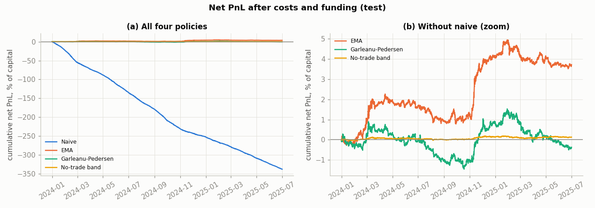

# From signal to portfolio

Andres Lee · research project, 2026

**Negative result, honestly tested.**
* **What was tested.** Six hourly signals, specified in advance (self-declared, not
  independently timestamped), on the 25 most-traded Binance USDT
  perpetuals (2021–2026), traded four ways: naive rebalancing, an EMA-smoothed target,
  Garleanu-Pedersen (GP) dynamic trading, and a proportional-cost no-trade band.
* **The signals.** Two short-term reversal signals predict the next hour with high statistical
  significance, but their effect is gone within a few hours and is worth less than 1 bp per unit
  traded. Out of sample, the combined forecast loses money before costs.
* **Naive trading** loses about 160–225% of capital a year in costs.
* **The cost-aware policies** avoid that loss mainly by hardly trading. Their net Sharpe ratios
  are statistically indistinguishable from zero in both the test period and the one-off holdout.
* **The trading theory works.** The GP and band solutions are derived from scratch and validated
  numerically. They behave exactly as theory predicts in simulation. On this data there is simply
  no net alpha for them to capture at the assumed costs.

## Headline results

Net Sharpe ratio, annualised, with 95% circular block-bootstrap CI (1-week blocks). Costs are
4.5 bp fee + 2 bp half-spread per unit traded, plus square-root-calibrated impact. Capital is
USD 10m, fixed. All parameters were chosen on train (2021-07 – 2023-12).

| policy | test 2024-01 – 2025-06 | holdout 2025-07 – 2026-10-27 (run once) | test avg gross exposure | test turnover ×/yr |
|---|---|---|---|---|
| naive | −53.6 [−58.1, −49.1] | −49.0 [−52.0, −46.1] | 19.0% | 1,038 |
| EMA | +1.48 [−0.29, 3.23] | −0.98 [−3.00, 1.35] | 6.9% | 8.1 |
| Garleanu-Pedersen | −0.16 [−1.80, 1.46] | +0.61 [−0.96, 2.06] | 6.2% | 9.2 |
| no-trade band ¹ | +0.51 [−0.75, 1.79] | +0.92 [−0.42, 2.35] | 0.3% | 0.03 |

¹ The band's book is near-empty: about 0.3% of capital, never 1% of capital in any test hour.
Its Sharpe is not comparable to the other rows.



* **Trials counted:** 94 on test, 119 including the holdout, 139 including post-hoc checks.
* **Haircut.** In the main tables, the deflated-Sharpe probability that a policy beats the best
  of 94 noise strategies (test) or 119 (holdout) is at most 0.24 and 0.07 respectively. It is at
  most 0.35 in the post-hoc low-cost rows.
* **Signals.** The strongest is 4-hour reversal: test IC 0.028, t between 8.9 and 12.1 across
  ten dependence corrections. Its break-even cost is 0.75 bp per unit traded on train, and it is
  negative on test (losing before costs).

Full report: [`report.md`](report.md). One page: [`SUMMARY.md`](SUMMARY.md). Derivations:
[`THEORY.md`](THEORY.md). Data: [`DATA.md`](DATA.md).

## Methods

| area | what is implemented | where |
|---|---|---|
| Stochastic control | linear-quadratic DP, Riccati recursion and DARE; equals Gârleanu-Pedersen (2013) Props. 2–4 | `s2p/lq.py`, `THEORY.md` §2 |
| Numerical DP | proportional-cost no-trade band, O(grid) Bellman step checked against exhaustive search | `s2p/dp.py`, `THEORY.md` §3 |
| Return prediction | cross-sectional rank and Pearson ICs, decay curves, walk-forward ridge combination | `s2p/signals.py`, `s2p/research.py` |
| Inference | Newey-West and Fama-MacBeth t-stats, Holm correction, circular block-bootstrap Sharpe CIs, deflated Sharpe over all counted trials | `s2p/stats.py` |
| Execution costs | fee + half-spread plus quadratic impact calibrated to the square-root law | `s2p/costs.py` |
| Data | point-in-time universe with delisted contracts kept, checksum-verified downloads, quality checks | `s2p/download.py`, `s2p/data.py`, `DATA.md` |

## Reproduce

Python 3.13. Pinned dependencies: numpy, pandas, scipy, matplotlib, pyyaml, pytest.

```bash
pip install -r requirements.txt
python -m pytest -q                 # data-free and synthetic tests (also run in CI)
python -m s2p.download              # public Binance Vision files, cached and SHA-256 verified
python -m s2p.run_all               # every train/test table and figure in results/ (~10-15 min)
python -m s2p.run_all --synthetic   # optional: whole pipeline on synthetic data -> results/synthetic/
```

`python -m s2p.run_all --holdout` is the one-off holdout evaluation. It has been run.
`results/HOLDOUT_RUN.txt` exists, so the command now refuses to run. Everything is driven by
[`config.yaml`](config.yaml): signals, dates, cost assumptions, tuning grids and the seed.

## Layout

| path | what it does |
|---|---|
| `config.yaml` | the single configuration (specified in advance, self-declared and not independently timestamped; later changes are commented in place) |
| `s2p/lq.py` | Riccati / Garleanu-Pedersen solution (finite and infinite horizon, closed forms) |
| `s2p/dp.py` | grid dynamic programmes: brute-force check, proportional-cost no-trade band |
| `s2p/sim.py`, `s2p/theory_report.py` | Monte Carlo on simulated signals; theory tables and figure |
| `s2p/download.py`, `s2p/data.py` | downloader; parsing, point-in-time universe, holdout cut, quality checks |
| `s2p/signals.py`, `s2p/research.py` | signals; IC, decay, dependence-robust t-stats, Holm; walk-forward ridge |
| `s2p/costs.py`, `s2p/backtest.py` | cost model; the four policies and PnL accounting |
| `s2p/stats.py` | block bootstrap, Newey-West, deflated Sharpe, trial log |
| `s2p/run_all.py` | the one command |
| `tests/` | theory validation, band DP, look-ahead, PnL reconciliation, data checks, statistics, guards |
| `tools/numexpr_race_repro.py` | standalone reproduction of the numexpr bug (see Limitations) |
| `results/` | every table (`.md` + `.csv`) and figure; `synthetic/` holds SYNTHETIC-labelled pipeline checks |
| `data/` | raw downloads and caches (not in git; rebuilt by the commands above) |

## Limitations

* **Costs are assumptions.**
  * The fee is Binance's retail taker rate.
  * The 2 bp half-spread and the impact coefficient are guesses; results are shown at 0×–4×.
  * A post-hoc check at 1–6.5 bp (test only) changes no conclusion.
* **No quote data.** Hourly klines contain only last-trade prices, so spreads, bid-ask bounce and
  realistic fill prices cannot be measured. Decisions and fills both use the hourly close.
* **Decisions taken after seeing data**, all commented in `config.yaml` and listed in
  `report.md` §8:
  * excluding 15 non-crypto contracts after seeing the universe list;
  * repairing truncated Binance monthly files from daily files;
  * diagnostic columns and a grid-edge check added after the first real run;
  * ending the holdout on 2026-10-27, because the source has no data for 2026-10-28;
  * after the holdout: the IC robustness audit, the band exposure columns and the post-hoc cost
    analysis.
* **The intermittent NaN bug: root-caused, not reported upstream.**
  * The cause is a race in numexpr 2.14.1's multithreaded evaluation. It occasionally returns an
    unfilled output: wrong in 0.1–0.3% of multithreaded calls on large arrays, and never with
    1 thread.
  * pandas' numexpr path is disabled on import, guards stop the run on non-finite estimates, and
    two pipeline runs from scratch give exactly identical tables and figures.
  * Why the race happens, and on which machines, is not established.
* **The theory, not the paper's application, is reproduced.** The GP solution was derived from
  scratch, validated numerically, and checked against the published paper: tests confirm it
  equals the paper's Propositions 2–4 (`THEORY.md` §0 gives equation numbers). The paper's
  commodity-futures results are not replicated.
* **The holdout was run once and is spent** (self-declared; see Version history). Statistics added after it (robustness t-stats, time
  in market) are available for train and test only.
* **Other limitations:**
  * diagonal risk model;
  * no forced market neutrality;
  * delisted positions exit at the last traded price;
  * crypto-specific risks such as exchange failure and auto-deleveraging are not modelled;
  * 18 months of test can only detect large Sharpe ratios (CI half-width about 1.7).

## Version history

The project was not under version control while it was built. **The first git commit was made
after the holdout had already been run**, so git history cannot show that the settings in `config.yaml`,
specified in advance (self-declared, not independently timestamped), came before the results. The comments in `config.yaml` and `report.md` §8 list
every choice made after seeing data.

## References

* Gârleanu, N. and Pedersen, L. H. (2013). Dynamic trading with predictable returns and
  transaction costs. *Journal of Finance* 68(6), 2309–2340.
* Bailey, D. H. and López de Prado, M. (2014). The deflated Sharpe ratio: correcting for
  selection bias, backtest overfitting and non-normality. *Journal of Portfolio Management*
  40(5), 94–107.

## Ground rules

No live trading and no API keys. Tests check for look-ahead in the signal and backtest code
(`tests/test_lookahead.py`).
Parameters are tuned on train only. The holdout is cut at load time and run once. Every variant
tried is counted. Anything made from synthetic data is labelled SYNTHETIC.
